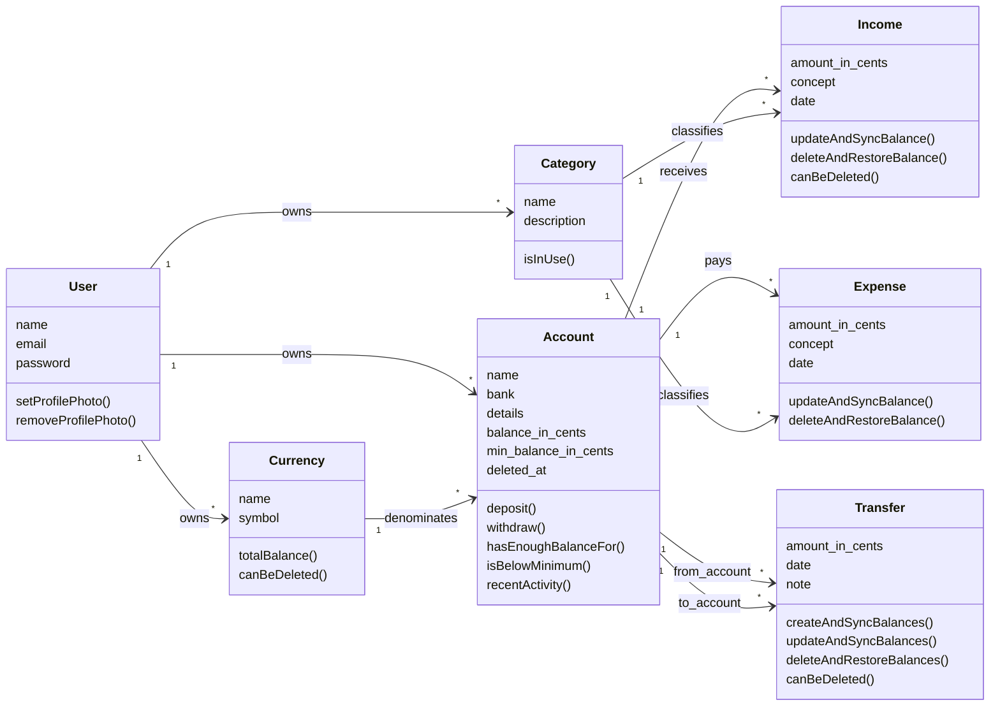

# Saldo

Saldo is a personal expense tracker. You keep your bank accounts, cash and cards in one place, record every income and expense, move money between your own accounts, and always see where the balance of each account stands.

The balances are the heart of the app: every income, expense and transfer updates the right account at the moment it is saved, and correcting or deleting an entry puts the numbers back exactly. An account can never be left below zero by an expense, a correction or a deletion.

## Features

- **Accounts:** each account has a bank, a currency, optional details and an optional minimum balance. The dashboard warns you when a balance falls under that minimum. An account is deactivated instead of deleted, so its history is never lost.
- **Incomes and expenses:** each entry has an amount, a date, a concept, an account and a category. The balance follows automatically. Entries can be corrected (every field) or deleted, and the lists are grouped by month and can be filtered by account, category and period.
- **Transfers:** move money between two of your own accounts of the same currency. A transfer shows in the history of both accounts and is never counted as an income or an expense.
- **Categories and currencies:** each user keeps their own. A category that is already used by an entry, and a currency that is already used by an account, cannot be deleted.
- **Dashboard:** the balance of every account, plus two charts for the account you choose: income against expenses over the last six months, and this month's spending by category.
- **Profile:** change your name, email and profile photo, or delete your account.
- **Safe by design:** every user only sees and changes their own data, every write is recorded in an audit log, responses carry security headers, and every form explains in plain words what to correct.

## Technology stack

| Area | What is used |
| ---- | ------------ |
| Language and framework | PHP 8.5, Laravel 13 |
| Views and interactivity | Blade templates, Alpine.js |
| Styling and assets | Tailwind CSS 4, built with Vite 8 |
| Database | SQLite by default, configurable for MySQL or PostgreSQL |
| File uploads | Spatie Laravel Media Library, on a local disk or on Amazon S3 |
| Tests and code style | Pest 5, Laravel Pint |


Saldo is built with [Laravel](https://laravel.com).

## Getting started

### Requirements

- **PHP 8.5** with the extensions `ctype`, `dom`, `exif`, `fileinfo`, `gd`, `mbstring`, `openssl`, `pdo_sqlite`, `sqlite3`, `tokenizer` and `xml` (check with `php -m`)
- **Composer 2**
- **Node.js 22** and npm
- **Git**

### Install

```bash
# 1. Get the code
git clone https://github.com/Dava2310/Expense-Tracker.git saldo
cd saldo

# 2. Install the PHP packages (Laravel included)
composer install

# 3. Create the environment file and the application key
cp .env.example .env
php artisan key:generate

# 4. Create the SQLite database and its tables
touch database/database.sqlite
php artisan migrate

# 5. Install the JavaScript packages and build the CSS and JavaScript
npm install
npm run build

# 6. Make the uploaded profile photos reachable from the browser
php artisan storage:link
```

Optional: fill the database with example data (this wipes it first). You can then sign in with `test@example.com` and the password `password`.

```bash
php artisan migrate:fresh --seed
```

### Run

```bash
composer dev
```

This starts the web server at <http://localhost:8000> together with the queue listener, the log viewer and Vite. It needs the `pcntl` PHP extension (available on Linux, macOS and WSL). To only browse the app, `php artisan serve` is enough.

### Test and check the code style

```bash
composer test            # run the test suite
vendor/bin/pint          # fix the code style
vendor/bin/pint --test   # report style problems without changing anything
```

## Data model

The diagram shows the seven models, their main columns and methods, and how they relate. Money is stored as whole cents (`*_in_cents`) and read as decimals through an `amount` or `balance` property. Accounts are never deleted, only deactivated (`deleted_at`).



Profile photos are stored by the Spatie Media Library in its own `media` table, linked to the user.

## Documentation

- [Entity-relationship diagram](docs/Entity-Relationship-Diagram.drawio.png) (editable source: [`.drawio`](docs/Entity-Relationship-Diagram.drawio))
- [Functional requirements](docs/functional-requirements-mvp.md)

## Deploy on AWS (EC2)

This guide puts Saldo on a single Ubuntu 24.04 EC2 instance, with SQLite on the same server, PHP-FPM and either Caddy or nginx. It assumes you already have the instance, its SSH key and, for HTTPS, a domain name. Replace `your-domain.com`, `KEY.pem` and `EC2_PUBLIC_IP` with your own values.

### 1. Prepare the instance

In the EC2 console, open these inbound ports in the instance's security group: **22** (SSH, ideally only from your IP), **80** (HTTP) and **443** (HTTPS). If you have a domain, point an `A` record at the instance's public IP (an Elastic IP keeps it from changing).

```bash
ssh -i KEY.pem ubuntu@EC2_PUBLIC_IP
sudo apt update && sudo apt upgrade -y
```

### 2. Install PHP, Composer, Node.js and Git

```bash
# PHP 8.5 (not in Ubuntu's own repositories, so add the ondrej/php repository)
sudo apt install -y software-properties-common
sudo add-apt-repository -y ppa:ondrej/php
sudo apt update
sudo apt install -y php8.5-cli php8.5-fpm php8.5-sqlite3 php8.5-gd php8.5-mbstring php8.5-xml php8.5-curl php8.5-zip php8.5-intl php8.5-bcmath

# Composer
sudo apt install -y curl unzip git
curl -sS https://getcomposer.org/installer -o composer-setup.php
sudo php composer-setup.php --install-dir=/usr/local/bin --filename=composer
rm composer-setup.php

# Node.js 22 (NodeSource)
curl -fsSL https://deb.nodesource.com/setup_22.x -o nodesource_setup.sh
sudo -E bash nodesource_setup.sh
sudo apt install -y nodejs
rm nodesource_setup.sh
```

Laravel itself needs no separate installation: Composer installs it with the other packages in step 4. Check the versions with `php -v`, `composer --version` and `node -v`.

Photos can be up to 2 MB, which is the same as PHP's default upload limit, so raise it a little:

```bash
printf "upload_max_filesize = 4M\npost_max_size = 8M\n" | sudo tee /etc/php/8.5/fpm/conf.d/99-saldo.ini
sudo systemctl restart php8.5-fpm
```

### 3. Get the code

```bash
sudo mkdir -p /var/www/saldo
sudo chown ubuntu:ubuntu /var/www/saldo
git clone https://github.com/Dava2310/Expense-Tracker.git /var/www/saldo
cd /var/www/saldo
```

### 4. Install and build

```bash
composer install --no-dev --optimize-autoloader
npm ci
npm run build
```

### 5. Configure the environment

```bash
cp .env.example .env
nano .env
```

Change these values and leave the rest as it is:

```ini
APP_NAME=Saldo
APP_ENV=production
APP_DEBUG=false
APP_URL=https://your-domain.com
LOG_LEVEL=warning
DB_CONNECTION=sqlite
```

With SQLite the database is the file `database/database.sqlite`, so no other database setting is needed. Without a domain, use `APP_URL=http://EC2_PUBLIC_IP`. Photos are stored on the server (`MEDIA_DISK=public`). To keep them on Amazon S3 instead, set `MEDIA_DISK=s3` and the `AWS_*` values in the same file.

Saldo does not use a queue worker, so there is nothing to keep running besides the web server and PHP-FPM.

#### Using MySQL or PostgreSQL instead of SQLite

Install the server and the PHP driver, then create an empty database and a user for it. **MySQL:**

```bash
sudo apt install -y mysql-server php8.5-mysql
sudo mysql
```

```sql
CREATE DATABASE saldo CHARACTER SET utf8mb4 COLLATE utf8mb4_unicode_ci;
CREATE USER 'saldo'@'localhost' IDENTIFIED BY 'choose-a-strong-password';
GRANT ALL PRIVILEGES ON saldo.* TO 'saldo'@'localhost';
```

**PostgreSQL:**

```bash
sudo apt install -y postgresql php8.5-pgsql
sudo -u postgres psql
```

```sql
CREATE USER saldo WITH PASSWORD 'choose-a-strong-password';
CREATE DATABASE saldo OWNER saldo;
```

Then replace the `DB_CONNECTION=sqlite` line in `.env` with the settings for your choice (`mysql` uses port 3306, `pgsql` port 5432):

```ini
DB_CONNECTION=mysql
DB_HOST=127.0.0.1
DB_PORT=3306
DB_DATABASE=saldo
DB_USERNAME=saldo
DB_PASSWORD=choose-a-strong-password
```

### 6. Generate the key, set permissions and create the database

```bash
php artisan key:generate --force

# The web server runs as www-data: it must read .env and write to these folders
sudo chgrp www-data .env && chmod 640 .env
sudo chown -R www-data:www-data storage bootstrap/cache database

# SQLite only: create the database file
sudo -u www-data touch database/database.sqlite

# Create the tables (do not run the seeder in production: it creates example users)
sudo -u www-data php artisan migrate --force

# Make the uploaded photos reachable from the browser
php artisan storage:link
```

### 7. Optimize for production

```bash
sudo -u www-data php artisan config:cache
sudo -u www-data php artisan route:cache
sudo -u www-data php artisan view:cache
sudo -u www-data php artisan event:cache
```

`php artisan optimize` runs all four at once. Run these again after every change to `.env`.

### 8. Set up the web server

Use **either** Caddy **or** nginx, not both: they would fight for ports 80 and 443. PHP-FPM must be running for both: `sudo systemctl enable --now php8.5-fpm`.

#### Option A: Caddy (automatic HTTPS)

```bash
sudo apt install -y debian-keyring debian-archive-keyring apt-transport-https curl
curl -1sLf 'https://dl.cloudsmith.io/public/caddy/stable/gpg.key' | sudo gpg --dearmor -o /usr/share/keyrings/caddy-stable-archive-keyring.gpg
curl -1sLf 'https://dl.cloudsmith.io/public/caddy/stable/debian.deb.txt' | sudo tee /etc/apt/sources.list.d/caddy-stable.list
sudo chmod o+r /usr/share/keyrings/caddy-stable-archive-keyring.gpg
sudo chmod o+r /etc/apt/sources.list.d/caddy-stable.list
sudo apt update
sudo apt install caddy
```

Replace the contents of `/etc/caddy/Caddyfile` (`sudo nano /etc/caddy/Caddyfile`) with:

```
your-domain.com {
    root * /var/www/saldo/public
    encode zstd gzip
    php_fastcgi unix//run/php/php8.5-fpm.sock
    file_server
}
```

```bash
sudo systemctl reload caddy
```

Caddy gets and renews the HTTPS certificate by itself, as long as the domain points at the instance and ports 80 and 443 are open. Without a domain, write `:80 {` instead of `your-domain.com {` and use plain HTTP.

#### Option B: nginx

```bash
sudo apt install -y nginx
sudo nano /etc/nginx/sites-available/saldo
```

```nginx
server {
    listen 80;
    server_name your-domain.com;
    root /var/www/saldo/public;
    index index.php;
    client_max_body_size 4M;

    location / {
        try_files $uri $uri/ /index.php?$query_string;
    }

    location ~ \.php$ {
        include snippets/fastcgi-php.conf;
        fastcgi_pass unix:/run/php/php8.5-fpm.sock;
    }

    location ~ /\.(?!well-known) {
        deny all;
    }
}
```

```bash
sudo ln -s /etc/nginx/sites-available/saldo /etc/nginx/sites-enabled/saldo
sudo rm -f /etc/nginx/sites-enabled/default
sudo nginx -t
sudo systemctl reload nginx
```

For HTTPS, let Certbot add the certificate and the redirect:

```bash
sudo apt install -y certbot python3-certbot-nginx
sudo certbot --nginx -d your-domain.com
```

### 9. Check it works

Open `https://your-domain.com` (or `http://EC2_PUBLIC_IP`), register the first user and add an account. If you get an error page, read `/var/www/saldo/storage/logs/laravel.log`.

### Deploying an update

```bash
cd /var/www/saldo
sudo -u www-data php artisan down
sudo chown -R ubuntu:ubuntu /var/www/saldo
git pull
composer install --no-dev --optimize-autoloader
npm ci && npm run build
sudo chown -R www-data:www-data storage bootstrap/cache database
sudo -u www-data php artisan migrate --force
sudo -u www-data php artisan optimize
sudo systemctl reload php8.5-fpm
sudo -u www-data php artisan up
```

With SQLite, back up `database/database.sqlite` and `storage/app/public` (the photos) regularly.
