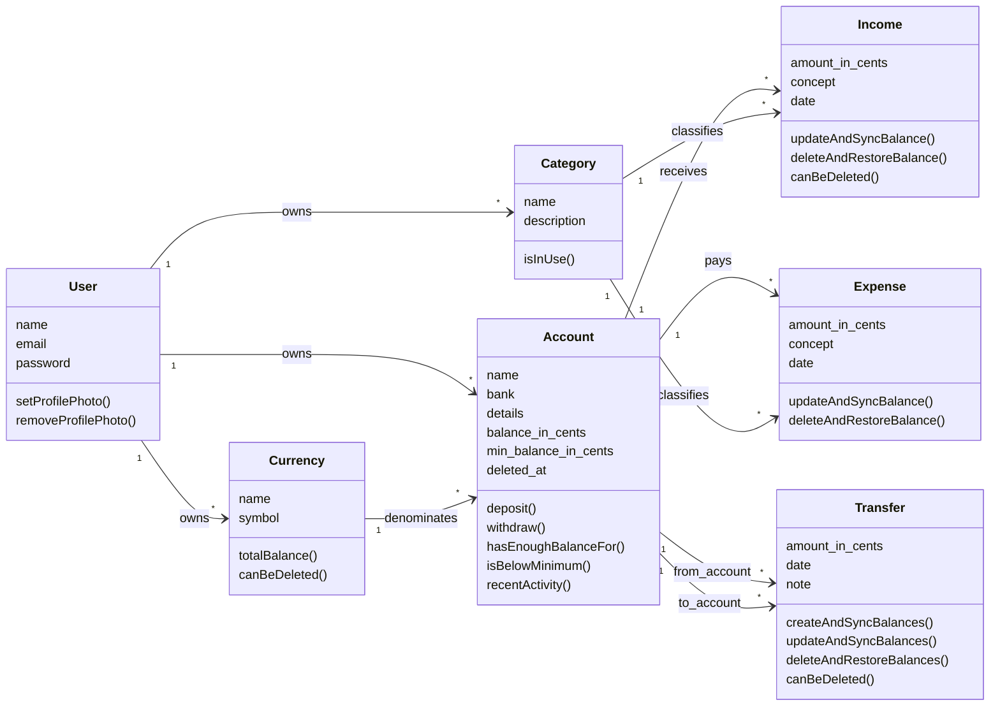

# Saldo

Saldo is a personal expense tracker. You keep your bank accounts, cash and cards in one place, record every income and expense, move money between your own accounts, and always see where the balance of each account stands.

The balances are the heart of the app: every income, expense and transfer updates the right account at the moment it is saved, and correcting or deleting an entry puts the numbers back exactly. An account can never be left below zero by an expense, a correction or a deletion.

## Features

- **Accounts:** each account has a bank, a currency, optional details and an optional minimum balance. The dashboard warns you when a balance falls under that minimum. An account is deactivated instead of deleted, so its history is never lost.
- **Incomes and expenses:** each entry has an amount, a date, a concept, an account and a category. The balance follows automatically. Entries can be corrected (every field) or deleted, and the lists are grouped by month and can be filtered by account, category and period.
- **Transfers:** move money between two of your own accounts of the same currency. A transfer shows in the history of both accounts and is never counted as an income or an expense.
- **Categories and currencies:** each user keeps their own. A category that is already used by an entry, and a currency that is already used by an account, cannot be deleted.
- **Dashboard:** the balance of every account, plus two charts for the account you choose: income against expenses over the last six months, and this month's spending by category.
- **Profile:** change your name, email and profile photo, or delete your account.
- **Safe by design:** every user only sees and changes their own data, every write is recorded in an audit log, responses carry security headers, and every form explains in plain words what to correct.

## Technology stack

| Area | What is used |
| ---- | ------------ |
| Language and framework | PHP 8.5, Laravel 13 |
| Views and interactivity | Blade templates, Alpine.js |
| Styling and assets | Tailwind CSS 4, built with Vite 8 |
| Database | SQLite by default, configurable for MySQL or PostgreSQL |
| File uploads | Spatie Laravel Media Library, on a local disk or on Amazon S3 |
| Tests and code style | Pest 5, Laravel Pint |


Saldo is built with [Laravel](https://laravel.com).

## Getting started

### Requirements

- **PHP 8.5** with the extensions `ctype`, `dom`, `exif`, `fileinfo`, `gd`, `mbstring`, `openssl`, `pdo_sqlite`, `sqlite3`, `tokenizer` and `xml` (check with `php -m`)
- **Composer 2**
- **Node.js 22** and npm
- **Git**

### Install

```bash
# 1. Get the code
git clone https://github.com/Dava2310/Expense-Tracker.git saldo
cd saldo

# 2. Install the PHP packages (Laravel included)
composer install

# 3. Create the environment file and the application key
cp .env.example .env
php artisan key:generate

# 4. Create the SQLite database and its tables
touch database/database.sqlite
php artisan migrate

# 5. Install the JavaScript packages and build the CSS and JavaScript
npm install
npm run build

# 6. Make the uploaded profile photos reachable from the browser
php artisan storage:link
```

Optional: fill the database with example data (this wipes it first). You can then sign in with `test@example.com` and the password `password`.

```bash
php artisan migrate:fresh --seed
```

### Run

```bash
composer dev
```

This starts the web server at <http://localhost:8000> together with the queue listener, the log viewer and Vite. It needs the `pcntl` PHP extension (available on Linux, macOS and WSL). To only browse the app, `php artisan serve` is enough.

### Test and check the code style

```bash
composer test            # run the test suite
vendor/bin/pint          # fix the code style
vendor/bin/pint --test   # report style problems without changing anything
```

## Data model

The diagram shows the seven models, their main columns and methods, and how they relate. Money is stored as whole cents (`*_in_cents`) and read as decimals through an `amount` or `balance` property. Accounts are never deleted, only deactivated (`deleted_at`).



Profile photos are stored by the Spatie Media Library in its own `media` table, linked to the user.

## Documentation

- [Entity-relationship diagram](docs/Entity-Relationship-Diagram.drawio.png) (editable source: [`.drawio`](docs/Entity-Relationship-Diagram.drawio))
- [Functional requirements](docs/functional-requirements-mvp.md)
